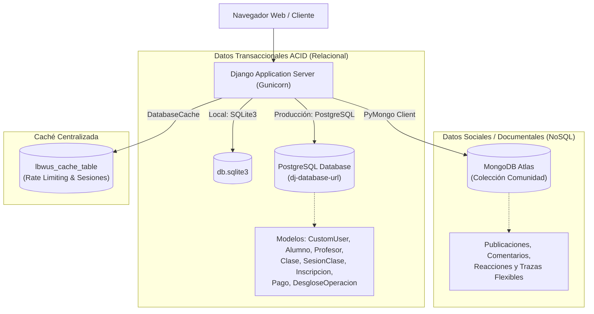
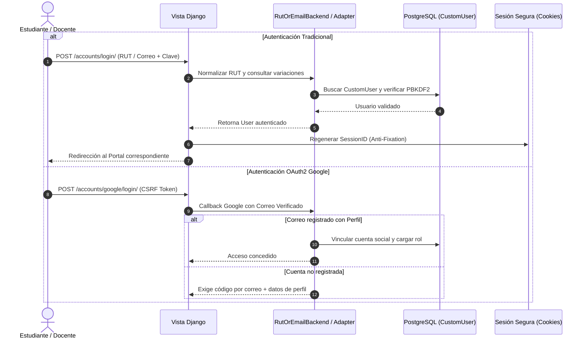

# 📘 Informe Técnico Integral del Proyecto LBWUS (Learn Better With Us)

**Proyecto:** LBWUS (Learn Better With Us)  
**Nivel de Documento:** Informe Técnico de Arquitectura, Seguridad, Datos y Autenticación  
**Fecha de Emisión:** 30 de Octubre de 2026  
**Entorno de Despliegue:** Railway PaaS (`https://capstone-production-eddd.up.railway.app` / Dominio: `https://lbwus.xyz`)  
**Estándares de Referencia:** OWASP Top 10 (2021/2026), NIST SP 800-63B, RFC 7231 / RFC 9110, Django 5.x Security Guidelines, Transbank Webpay Plus Integration Standard v6.1  
**Estado de Validación de Software:** ✅ 253 pruebas unitarias, de integración, seguridad y concurrencia ejecutadas con éxito (100% aprobadas).

---

## 📑 Tabla de Contenidos
1. [Resumen Ejecutivo y Visión General del Proyecto](#1-resumen-ejecutivo-y-visión-general-del-proyecto)
2. [Lenguajes y Stack Tecnológico](#2-lenguajes-y-stack-tecnológico)
   - 2.1 Backend: Python 3.14 y Django Framework
   - 2.2 Frontend: HTML5 Semántico, Vanilla CSS y JavaScript Nativo
   - 2.3 Capa de Despliegue y Servidor WSGI: Gunicorn y WhiteNoise
   - 2.4 Ecosistema de Librerías y Dependencias Principales
3. [Arquitectura de Datos y Bases de Datos Utilizadas](#3-arquitectura-de-datos-y-bases-de-datos-utilizadas)
   - 3.1 Enfoque Híbrido / Políglota
   - 3.2 Base de Datos Relacional Principal: SQLite (Local) y PostgreSQL (Producción)
   - 3.3 Base de Datos No Relacional (NoSQL): MongoDB Atlas (App Comunidad)
   - 3.4 Persistencia de Caché Centralizada: DatabaseCache
4. [Métodos y Arquitectura de Autenticación](#4-métodos-y-arquitectura-de-autenticación)
   - 4.1 Autenticación Tradicional Híbrida (RUT, Correo o Nombre de Usuario)
   - 4.2 Autenticación Social Federada (OAuth2 con Google)
   - 4.3 Autenticación Passwordless y Gestión de Roles Especiales (Profesores y Tutores)
5. [Métodos y Mecanismos de Seguridad](#5-métodos-y-mecanismos-de-seguridad)
   - 5.1 Mitigación de Vulnerabilidades OWASP Top 10
   - 5.2 Protección CSRF y Blindaje en Métodos HTTP (S-19 y S-20)
   - 5.3 Control de Concurrencia y Blindaje Transaccional (Locks a Nivel de Fila)
   - 5.4 Seguridad en Pasarela de Pagos (Transbank Webpay Plus)
   - 5.5 Sanitización de Trazas de Error y Puerta de Acceso Global
6. [Justificación Arquitectural: ¿Por Qué Funciona Así?](#6-justificación-arquitectural-por-qué-funciona-así)
7. [Métricas de Calidad y Verificación de Pruebas](#7-métricas-de-calidad-y-verificación-de-pruebas)

---

## 1. Resumen Ejecutivo y Visión General del Proyecto

**LBWUS (Learn Better With Us)** es una plataforma web universitaria orientada al auto-aprendizaje colaborativo y la mentoría académica. Su misión es conectar a **alumnos**, **profesores (tutores)** y **administradores** dentro de un ecosistema digital seguro, transparente y de alto rendimiento.

La plataforma resuelve problemáticas críticas del soporte universitario:
- **Para los Alumnos:** Catálogo de clases personalizadas, reserva ágil de bloques horarios y sesiones individuales, paquetes prepagados de clases (planes flexible, progreso e intensivo) y pasarela de pago segura sin suscripciones forzosas.
- **Para los Docentes:** Portal exclusivo de administración de disponibilidad horaria, control de alumnos inscritos, trazabilidad de ingresos devengados y carga de acreditaciones universitarias.
- **Para la Administración:** Panel de control para verificar y validar títulos de docentes antes de autorizar su oferta académica, monitoreo de fondos en custodia, resolución de incidencias/reportes y conciliación financiera en tiempo real.

---

## 2. Lenguajes y Stack Tecnológico

El proyecto sigue una filosofía de ingeniería orientada a la **simplicidad, mantenibilidad, robustez y ausencia de sobrecargas innecesarias**.

### 2.1 Backend: Python 3.14 y Django Framework
* **Lenguaje:** **Python (v3.14)**. Seleccionado por su legibilidad, tipado dinámico expresivo, madurez para aplicaciones web empresariales y extenso ecosistema científico y administrativo.
* **Framework:** **Django (>= 5.0.6)** bajo el patrón arquitectural **MTV (Model - Template - View)**.
* **¿Por qué Django?:**
  1. *Seguridad Integrada por Defecto:* Ofrece protección nativa contra inyecciones SQL (mediante consultas parametrizadas del ORM), protección CSRF automática, hashing de contraseñas de estándar criptográfico y defensas contra Clickjacking (`X-Frame-Options`) y MIME Sniffing (`X-Content-Type-Options`).
  2. *Robustez del ORM:* Permite mapear esquemas de datos relacionales con soporte a transacciones atómicas (`transaction.atomic()`), bloqueos pesimistas (`select_for_update()`) y restricciones complejas (`CheckConstraint`, `UniqueConstraint`).
  3. *Modularidad por Aplicaciones (Apps):* El sistema se estructura en componentes desacoplados:
     - `alumnos`: Gestión de catálogo, reservas, pagos, compras de planes e inicio de sesión.
     - `admin_portal`: Panel administrativo, moderación de reportes y validación de títulos.
     - `user_profesor`: Portal de docentes, gestión de agenda y subida de credenciales académicas.
     - `comunidad`: Módulo social/colaborativo desacoplado con almacenamiento documental.
     - `lbwus`: Configuración troncal, enrutamiento raíz, middlewares de seguridad y políticas globales.

### 2.2 Frontend: HTML5 Semántico, Vanilla CSS y JavaScript Nativo
* **HTML5 Semántico:** Uso exhaustivo de elementos semánticos (`<main>`, `<section>`, `<article>`, `<nav>`, `<form>`, `<button>`) que optimizan la accesibilidad (a11y), el SEO y la correcta jerarquía DOM.
* **Vanilla CSS Estructurado:**
  - *Regla de Diseño Estricta:* No se utilizan frameworks CSS pesados ni compiladores invasivos (como Tailwind CSS o Bootstrap SASS). Se emplean hojas de estilo `.css` limpias, legibles y de nombres semánticos planos (`.prof-card`, `.panel-table`, `.btn-logout`).
  - *Sistema de Variables Globales (`:root`):* Centralización de la paleta corporativa:
    - Morado corporativo: `--primary: #a855f7;` / `--primary-dark: #9333ea;`
    - Color de acento para llamadas a la acción (CTA): `--accent: #f59e0b;`
    - Contraste de texto y fondos: `--text: #111827;`, `--white: #ffffff;`
  - *Soporte Nativo de Modo Oscuro:* Implementado mediante selectores contextuales `body.dark-mode .clase`, garantizando persistencia en almacenamiento local y legibilidad sin parpadeos visuales.
* **JavaScript Nativo (ES6+) y SweetAlert2:**
  - Interacciones asíncronas mediante `fetch()` para el catálogo de horarios y reservas modales (`/alumnos/api/sesiones/`).
  - Eliminación de bibliotecas obsoletas como jQuery.
  - SweetAlert2 integrado para feedback visual inmediato en confirmaciones de reserva y notificaciones de éxito o error.

### 2.3 Capa de Despliegue y Servidor WSGI: Gunicorn y WhiteNoise
* **Gunicorn (v20.1.0):** Servidor HTTP WSGI basado en el modelo *pre-fork worker*. Cada worker maneja peticiones de forma aislada, garantizando alta concurrencia y tolerancia a fallos.
* **WhiteNoise (v6.12.0):** Middleware de Django configurado con `CompressedManifestStaticFilesStorage`. Permite que la propia aplicación Python sirva sus archivos estáticos con compresión Gzip/Brotli y hashes de versión en caché, eliminando la necesidad de configurar servidores web auxiliares como Nginx en despliegues sobre plataformas en la nube (Railway).

### 2.4 Ecosistema de Librerías Principales
- `psycopg2-binary` y `dj-database-url`: Conector de base de datos PostgreSQL de alto rendimiento con análisis dinámico de cadenas de conexión.
- `django-allauth`, `oauthlib`, `requests-oauthlib`: Gestión robusta del ciclo de vida OAuth2 para Google Social Login.
- `pymongo` y `mongomock`: Controlador oficial de MongoDB para interacciones documentales y emulador de pruebas en memoria.
- `transbank-sdk (v6.1.0)`: SDK oficial de Transbank para la integración de pagos electrónicos vía Webpay Plus.
- `cryptography` y `PyJWT`: Manejo de primitivas criptográficas y firmas digitales.
- `Pillow`: Procesamiento y validación de formatos de imagen y documentos en subidas de títulos.

---

## 3. Arquitectura de Datos y Bases de Datos Utilizadas

El sistema LBWUS implementa una **arquitectura de persistencia políglota**, seleccionando el motor de datos óptimo de acuerdo a las características de cada dominio funcional.



### 3.1 Enfoque Híbrido / Políglota
No existe un único motor de base de datos que resuelva de manera óptima las necesidades transaccionales críticas (donde la integridad financiera y de reservas es innegociable) y las necesidades de esquemas dinámicos (donde la flexibilidad en publicaciones de estudiantes es prioritaria). Por ello se combinan tres subsistemas de persistencia:

### 3.2 Base de Datos Relacional Principal (SQLite y PostgreSQL)
* **Entorno de Desarrollo:** **SQLite 3 (`db.sqlite3`)**.
  - *¿Por qué funciona así?:* Permite ejecución rápida y portable de pruebas unitarias y desarrollo local sin requerir demonios externos o contenedores pesados.
* **Entorno de Producción:** **PostgreSQL** inyectado a través de la variable `DATABASE_URL` con `conn_max_age=600` (reutilización de conexiones durante 10 minutos).
* **Propósito:** Aloja todo el núcleo de negocio: usuarios, perfiles, asignaturas, clases, sesiones, inscripciones, auditoría de pagos y liquidaciones contables.
* **Garantías y Restricciones a Nivel de Motor (Engine-level Constraints):**
  1. *Atomicidad y Bloqueos Pesimistas:* En operaciones de reserva de cupos, se utiliza `select_for_update()` dentro de `transaction.atomic()`, bloqueando temporalmente la fila en PostgreSQL para impedir sobrecupos ante peticiones simultáneas.
  2. *Restricciones de Unicidad Nativas (`UniqueConstraint`):*
     - `unique_inscripcion_alumno_sesion_activa`: Un alumno solo puede registrar una única inscripción activa (`confirmada` o `pendiente`) por cada sesión puntual.
     - `unique_inscripcion_alumno_clase_general`: Evita inscripciones duplicadas en clases generales recurrentes.
  3. *Restricciones de Comprobación (`CheckConstraint`):*
     - `sesion_fin_posterior_a_inicio`: Garantiza que `fecha_hora_fin > fecha_hora_inicio`.
     - `sesion_cupo_maximo_positivo`: Obliga a que `cupo_maximo > 0`.
     - `sesion_precio_no_negativo`: Impide que se ingresen precios inferiores a `$0`.

### 3.3 Base de Datos No Relacional (NoSQL): MongoDB Atlas (App Comunidad)
* **Motor:** **MongoDB** (Cloud Atlas) mediante el conector **PyMongo**.
* **Propósito:** Almacenar interacciones comunitarias, hilos de conversación, preguntas de estudiantes y metadatos no estructurados.
* **Estrategia de Desacoplamiento y Resiliencia (Graceful Degradation):**
  - El cliente se instancia de forma perezosa (*lazy singleton* protegido por candado `threading.Lock()`), garantizando que cada worker de Gunicorn obtenga su propia conexión tras el *fork* del proceso.
  - Si la variable `MONGODB_URI` no está configurada o si el clúster sufre una caída de red, la función `disponible()` captura el timeout (`MONGODB_TIMEOUT_MS = 5000`) y el sistema desactiva amigablemente el panel social, permitiendo que el 100% del resto de la plataforma (clases, pagos, login, administración) continúe operando sin errores 500.

### 3.4 Persistencia de Caché Centralizada: DatabaseCache
* **Backend:** `django.core.cache.backends.db.DatabaseCache` apuntando a la tabla `lbwus_cache_table`.
* **¿Por qué funciona así?:**
  - En plataformas PaaS con múltiples instancias o con workers multiproceso de Gunicorn, la memoria RAM local (`LocMemCache`) está aislada entre procesos.
  - Al utilizar la base de datos relacional compartida como backend de caché, los contadores de intentos fallidos de inicio de sesión, el bloqueo temporal de atacantes por IP o RUT (*rate limiting*) y las llaves de idempotencia de pagos se sincronizan globalmente y persisten incluso ante reinicios de contenedores.

---

## 4. Métodos y Arquitectura de Autenticación

El sistema implementa tres mecanismos de autenticación diseñados para distintos perfiles y requerimientos de seguridad:



### 4.1 Autenticación Tradicional Híbrida (RUT, Correo o Usuario)
* **Backend Personalizado:** `alumnos.backends.RutOrEmailBackend`.
* **Identificador Flexible y Normalización Canónica:**
  - Los estudiantes y docentes chilenos frecuentemente ingresan su cédula en múltiples formatos: `12.345.678-9`, `12345678-9`, `123456789` o `12345678-k`.
  - La función `normalizar_rut_canonico()` estandariza cualquier entrada al formato unívoco `XXXXXXXX-X` (sin puntos, con guión y dígito verificador en mayúscula).
  - La función `variaciones_rut()` genera todas las permutaciones admisibles para resolver la consulta en la base de datos mediante un único `Q(rut__in=...) | Q(email__iexact=...) | Q(username__in=...)`.
* **Almacenamiento Seguro de Contraseñas:**
  - Implementación del algoritmo **PBKDF2** con hash **SHA-256**, aplicando miles de rondas de iteración y una sal (*salt*) criptográfica pseudoaleatoria única por cada usuario.
  - Se imponen validadores obligatorios de fortaleza (`MinimumLengthValidator`, `CommonPasswordValidator`, `NumericPasswordValidator` y `UserAttributeSimilarityValidator`).
* **Protección contra Fuerza Bruta (Rate Limiting Canónico):**
  - La función `obtener_identificador_rate_limit()` vincula los intentos de inicio de sesión a la clave canónica del usuario. Esto neutraliza a atacantes que intenten saltarse el bloqueo probando la misma cuenta alternando entre su RUT con puntos, sin puntos o su correo electrónico.

### 4.2 Autenticación Social Federada (OAuth2 con Google)
* **Librería Base:** `django-allauth`.
* **Mitigación S-20 (OWASP Login CSRF):**
  - Se configuró estrictamente `SOCIALACCOUNT_LOGIN_ON_GET = False`.
  - El inicio de sesión con Google **exige obligatoriamente una petición POST con token CSRF válido**, eliminando por completo la posibilidad de que un tercero engañe al navegador de una víctima para enlazar involuntariamente su sesión a una cuenta ajena.
* **Adaptadores de Seguridad Personalizados:**
  - `LbwusSocialAdapter` y `LbwusAccountAdapter` (`alumnos/google_adapter.py`):
    1. *Cero Cuentas Huérfanas:* Django-allauth suele crear usuarios vacíos por defecto. El adaptador personalizado de LBWUS rechaza este comportamiento: si un usuario ingresa con Google pero no posee perfil en el sistema, es redirigido a un flujo de onboarding donde se le exige un código de seguridad enviado a su correo electrónico (`CODIGO_GOOGLE_MINUTOS = 10`, `CODIGO_GOOGLE_INTENTOS = 5`) y el llenado obligatorio de sus datos personales y RUT.
    2. *Control de Cuentas Suspendidas (S-16):* Si un usuario existente en el sistema tiene `is_active = False` (cuenta desactivada por administración), el adaptador rechaza inmediatamente el acceso de Google y no permite el ingreso a los portales.

### 4.3 Autenticación Passwordless y Gestión de Roles Especiales
* **Docentes y Tutores/Administradores:**
  - El portal de profesores y el acceso de tutores/administradores disponen de un flujo ágil de autenticación basado en la validación directa de identidad y verificación de roles (`alumnos/roles.py`).
  - La sesión del usuario almacena las claves contextuales `request.session['profesor_id']` o `request.session['admin_id']`.
* **Guardia de Acreditación Docente (`puede_hacer_clases`):**
  - Para garantizar la calidad y seriedad universitaria, un profesor no puede publicar clases ni recibir reservas de alumnos hasta que su título universitario haya sido validado y aprobado en el portal administrativo (`titulo_estado == 'aprobado'`).

---

## 5. Métodos y Mecanismos de Seguridad

El proyecto ha sido auditado y fortalecido siguiendo los principios de **Defensa en Profundidad (Defense in Depth)** y las directrices del **OWASP Top 10**.

### 5.1 Mitigación de Vulnerabilidades OWASP Top 10

| Categoría OWASP | Riesgo Potencial | Mitigación Implementada en LBWUS |
| :--- | :--- | :--- |
| **A01: Broken Access Control** | Acceso horizontal no autorizado (IDOR) o cierre de sesión involuntario. | Validación estricta de pertenencia en todas las vistas (`Inscripcion.objects.get(alumno=alumno)`). Cierres de sesión forzados por `POST` con token CSRF (S-19). Rutas de testing aisladas en producción (S-21). |
| **A02: Cryptographic Failures** | Exposición de credenciales o comunicaciones no cifradas en tránsito. | HSTS forzado (`SECURE_HSTS_SECONDS = 31536000`), redirección HTTPS automática (`SECURE_SSL_REDIRECT = True`), cookies `Secure` y `HttpOnly`. Filtro de reporte de excepciones que sanitiza secretos. |
| **A03: Injection** | Inyecciones SQL o NoSQL en formularios o APIs. | Uso mandatorio del ORM de Django (consultas preparadas y parametrizadas). Uso de PyMongo con validación de esquemas tipados y desinfección de operadores. |
| **A04: Insecure Design** | Sobrecupos en reservas masivas o cobros sin respaldo. | Bloqueo pesimista `select_for_update()` a nivel de fila y servicios de pago con recálculo de montos en backend (*Zero Trust*). |
| **A05: Security Misconfiguration** | Páginas de depuración con trazas visibles en producción. | `DEBUG = False` gestionado por variable de entorno. `FiltroReporteErrores` que oculta `MONGODB_URI`, `SECRET_KEY` y `SITIO_CLAVE`. |
| **A07: Identification & Auth Failures** | Ataques de fuerza bruta, login CSRF o reuso de sesiones. | Rate limiting canónico persistente en BD (`DatabaseCache`), `SOCIALACCOUNT_LOGIN_ON_GET = False` (S-20), tokens de reseteo de clave con tiempo de vida limitado (1 hora). |
| **A08: Software & Data Integrity** | Alteración de precios de compra o estados de pago no autorizados. | Pasarela Webpay con validación cruzada de `buy_order` y montos, bloqueo estricto de transacciones productivas reales en entornos de prueba. |

### 5.2 Protección CSRF y Blindaje en Métodos HTTP (S-19 y S-20)
* **Cierre de Sesión Seguro (S-19):**
  - Anteriormente, el cierre de sesión mediante peticiones `GET` exponía a los usuarios a ataques de **Logout CSRF** o **Denegación de Servicio (DoS)** (por ejemplo, incrustando `` en páginas externas).
  - Todas las vistas de salida (`logout_alumno`, `logout_prof`, `logout_admin`) fueron decoradas con `@require_POST` y `@never_cache`. Si un atacante o bot envía una solicitud `GET`, el servidor responde de forma inmediata con un código de estado HTTP `405 Method Not Allowed`.
  - Todos los botones de la interfaz de usuario (barra de navegación móvil, avatar de escritorio y barras laterales) fueron transformados en formularios HTML semánticos con la etiqueta ``.
* **Inicio de Sesión Social Seguro (S-20):**
  - Se configuró `SOCIALACCOUNT_LOGIN_ON_GET = False`.
  - La redirección a Google se ejecuta mediante formularios POST que envían el token anti-falsificación de Django, evitando que peticiones maliciosas externas provoquen inicios de sesión automáticos no deseados.
* **Aislamiento de Rutas de Depuración (S-21):**
  - Las rutas de prueba visual de páginas de error (`test404/` y `test500/`) fueron condicionadas dentro de `lbwus/urls.py` bajo la cláusula `if settings.DEBUG:`. En producción, estas rutas no existen en la tabla de enrutamiento y arrojan `404 Not Found`.

### 5.3 Control de Concurrencia y Blindaje Transaccional
Para impedir **condiciones de carrera (*race conditions*)** en la asignación de cupos de clases y sesiones:
1. **Bloqueo Pesimista a Nivel de Fila:**
   ```python
   with transaction.atomic():
       sesion = SesionClase.objects.select_for_update().get(pk=sesion_id)
       total_ocupados = sesion.inscripciones.select_for_update().filter(
           estado__in=['confirmada', 'pendiente']
       ).count()
       if total_ocupados >= sesion.cupo_maximo:
           raise CupoAgotadoError("No quedan cupos disponibles para esta sesión.")
       # Creación segura de la inscripción
   ```
2. **Restricción de Respaldo en la Base de Datos:**
   Si dos transacciones intentaran colisionar en el mismo milisegundo eludiendo la capa lógica, el motor PostgreSQL rechaza la segunda mediante la restricción `UniqueConstraint` (`unique_inscripcion_alumno_sesion_activa`), traduciéndose limpiamente en un error de dominio `InscripcionDuplicadaError`.

### 5.4 Seguridad en Pasarela de Pagos (Transbank Webpay Plus)
* **Prohibición Estricta de Cobros Reales:** En cumplimiento de las directrices académicas, la plataforma opera de manera forzada en entorno **Sandbox / Test oficial de Transbank** (código de comercio `597055555532`), requiriendo que la variable `TRANSBANK_PRODUCCION_HABILITADA` permanezca en `False`.
* **Zero Trust & Anti-Price Tampering:** El cliente jamás envía el monto final a cobrar. El endpoint `/iniciar_webpay/` ignora cualquier parámetro de precio remitido desde JavaScript; el total a pagar se computa exclusivamente en el backend leyendo el catálogo oficial.
* **Prevención de Ataques de Repetición (*Replay Attacks*):**
  - Al completar la transacción, la orden se extrae de la sesión del usuario (`request.session.pop('orden_compra_webpay', None)`).
  - El callback valida la idempotencia: si la orden ya figura como `pagada` en la base de datos, no se re-ejecuta el `.commit()` bancario, impidiendo dobles cargos por recarga de página.
* **Liquidación y Custodia Preventiva (S4-09):**
  - La plataforma retiene una comisión oficial del **15% IVA incluido** y asigna el **85%** al tutor.
  - Los fondos de paquetes prepagados se mantienen en **custodia preventiva** en el modelo `DesgloseOperacion`; los saldos solo se liberan a la billetera retirable del profesor a medida que las clases son efectivamente dictadas y consumidas por el alumno.

### 5.5 Sanitización de Trazas de Error y Puerta de Acceso Global
* **Filtro de Reporte de Errores (`lbwus.reporte_errores.FiltroReporteErrores`):**
  - Hereda de `SafeExceptionReporterFilter` de Django.
  - Oculta proactivamente de cualquier traza de error, correo de diagnóstico o volcado de pantalla los valores sensibles correspondientes a `MONGODB_URI`, `SITIO_CLAVE`, contraseñas de correo y claves secretas de Transbank.
* **Puerta con Clave para el Sitio (`lbwus.puerta.PuertaSitioMiddleware`):**
  - Middleware que actúa como escudo perimetral durante etapas de auditoría o marcha blanca cuando se define la variable `SITIO_CLAVE`.
  - Emplea `hmac.compare_digest` para evitar ataques de temporización (*timing attacks*) al validar la clave ingresada.
  - La función `destino_seguro()` previene vulnerabilidades de redirección abierta (*Open Redirect*), garantizando que el parámetro `?next=` siempre apunte a rutas internas del dominio.

---

## 6. Justificación Arquitectural: ¿Por Qué Funciona Así?

Toda decisión técnica en LBWUS responde a razones fundamentadas de ingeniería de software, seguridad de la información y viabilidad operacional:

1. **¿Por qué Vanilla CSS y no un Framework como Tailwind?:**
   - *Razón:* Las plataformas universitarias y proyectos Capstone requieren que futuros desarrolladores, diseñadores o evaluadores puedan inspeccionar y modificar estilos con conocimientos elementales de CSS. Tailwind genera clases utilitarias extensas y crípticas en el HTML que dificultan la auditoría manual de código y aumentan el acoplamiento a dependencias de Node.js en tiempo de compilación.
2. **¿Por qué PostgreSQL en Producción y SQLite en Desarrollo?:**
   - *Razón:* SQLite permite a cualquier integrante clonar el repositorio y ejecutar pruebas de inmediato sin instalar servicios externos. En producción, PostgreSQL es imprescindible porque implementa bloqueos a nivel de fila (`select_for_update`), concurrencia multihilo real, agrupación de conexiones (*connection pooling*) y restricciones avanzadas de integridad relacional que garantizan que jamás existan inscripciones duplicadas ni inconsistencias financieras.
3. **¿Por qué MongoDB aislado para la Comunidad?:**
   - *Razón:* Las publicaciones, comentarios, etiquetas e hilos de foros tienen estructuras heterogéneas que cambian con frecuencia. Forzar este contenido en tablas SQL requeriría continuas migraciones de esquema o múltiples uniones relacionales (*JOINs*) costosas. Además, al desacoplar MongoDB con tolerancia a fallos, una caída de la base de datos social no interrumpe el servicio central académico ni el procesamiento de pagos.
4. **¿Por qué forzar POST en Cierres de Sesión y Social Login?:**
   - *Razón:* Los estándares HTTP (RFC 7231 y RFC 9110) y las guías de OWASP establecen que el método `GET` debe ser idempotente y seguro (sin efectos secundarios en el estado de la aplicación). Permitir mutaciones de sesión vía `GET` abre la puerta a ataques de CSRF donde enlaces invisibles forzarían al usuario a salir de su cuenta o autenticarse involuntariamente con credenciales de un atacante.
5. **¿Por qué DatabaseCache en lugar de Memoria Local?:**
   - *Razón:* En un entorno como Railway con servidores Gunicorn, cada proceso worker tiene su propio espacio de memoria RAM. Si se utilizara memoria local, un atacante que realice intentos de fuerza bruta vería sus intentos distribuidos entre workers, evadiendo el rate limiting. Con `DatabaseCache`, todos los workers consultan la misma tabla de caché, aplicando las restricciones de seguridad de forma unificada y persistente.

---

## 7. Métricas de Calidad y Verificación de Pruebas

El repositorio cuenta con una exhaustiva suite de pruebas automatizadas que abarca pruebas unitarias, pruebas de integración de controladores, pruebas de estrés de concurrencia y validaciones de seguridad:

```text
----------------------------------------------------------------------
Ran 253 tests in 198.257s

OK (skipped=6)
Destroying test database for alias 'default'...
Found 253 test(s).
Cache table 'lbwus_cache_table' already exists.
System check identified no issues (0 silenced).
```

### Áreas Cubiertas por la Suite de Pruebas:
1. **Seguridad y Flujos de Autenticación (S-19, S-20, S-21):**
   - Verificación de rechazo con código `405 Method Not Allowed` ante peticiones `GET` en vistas de logout.
   - Verificación de obligatoriedad de token CSRF en login social de Google.
   - Aislamiento de vistas de error en entornos productivos.
2. **Blindaje de Concurrencia e Inscripciones:**
   - Pruebas multihilo con 10 o más hilos simultáneos compitiendo por un cupo limitado: exactamente el número de cupos permitidos es concedido y el resto de los hilos recibe limpiamente la excepción `CupoAgotadoError`.
   - Comprobación de integridad relacional mediante `UniqueConstraint` en base de datos.
3. **Seguridad en Pagos y Liquidaciones Financieras:**
   - Detección y bloqueo de manipulación de montos (*Price Tampering*).
   - Prevención de ataques de repetición (*Replay Attacks*) en callbacks de Transbank.
   - Cálculo exacto de la comisión del 15% IVA incluido y asignación del 85% a tutores.
4. **Resiliencia de MongoDB y Servicios Desacoplados:**
   - Operatividad del sistema ante ausencia o indisponibilidad de MongoDB Atlas.

---

*Informe técnico elaborado y consolidado para la entrega y auditoría del proyecto Capstone LBWUS.*
